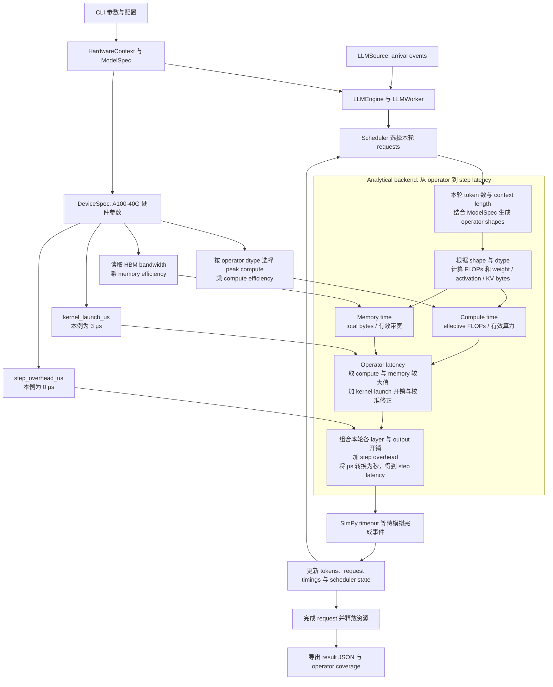
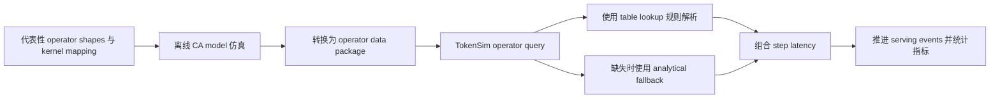

# 通过默认示例学习 TokenSim 架构

## 范围与输入

TokenSim 使用 SimPy virtual clock，将 serving 表示为 discrete events。
host 执行 Python 代码以调度 events、构建 operator shapes 并计算 latency。
模拟的 AI芯片 由 Device Capabilities 描述，模型由 geometry 描述。
模型规模影响估算的计算量和存储量，运行时不加载 weights，也不执行模型的 GEMM 等运算。

- Model Geometry（模型结构参数）：描述 LLM 网络结构及其关键维度，包括层数、隐藏层维度、Attention Head 数量、FFN 维度等，用于推导 Operator 的张量形状、计算量与访存需求，为性能建模提供输入。
- Device Capabilities（硬件能力参数）：描述 AI 芯片的计算能力、内存容量、带宽等，用于推导 Operator 的执行时间和访存开销，为性能建模提供输入。

下面的数值来自本例的 YAML 配置；标注“默认”的字段由加载代码补齐。
参数表描述 simulator 使用的输入值，其中 hardware specifications、经验校准值和默认假设的来源不同。

### Model Geometry：Llama-7B

配置来源为 [llama-7b.yaml](../data/models/llama-7b.yaml)，字段定义和默认值见 [ModelSpec](../TokenSim/config/model_config.py)。

| 类别 | 参数 | 本例值 | 含义与仿真用途 |
| --- | --- | --- | --- |
| 标识 | `model_id` | `llama-7b` | Model catalog 的标识，用于解析配置和标记结果 |
| 标识 | `display_name`、`aliases` | LLaMA 7B / Llama-2-7B；别名含 `LLaMa-7B` | CLI 默认值 `LLaMa-7B` 通过 alias 解析到该配置 |
| 结构 | `num_layers` | 32 | Transformer layer 数量，决定重复计算的层数与各层 KV 总量 |
| 结构 | `hidden_size` | 4096 | 每个 token 的 hidden vector 宽度，决定 projections、residual 和 normalization 的维度 |
| FFN | `intermediate_size` | 11008 | FFN 中间宽度，影响 gate、up 和 down projections 的 shape 与参数量 |
| FFN | `activation` | `swiglu` | 使用 gated activation，包含 gate、up 两个输入 projections 和一个 down projection |
| Attention | `num_attention_heads` | 32 | Query heads 数量，影响 attention 计算量；Q projection 总宽度为 32 × 128 = 4096 |
| Attention | `num_key_value_heads` | 32 | K、V 各自的 heads 数量，决定 KV storage 宽度；本例与 query heads 数量相同 |
| Attention | `head_dim` | 128 | 单个 head 的 vector 宽度；32 × 128 = `hidden_size` |
| Attention | `attention_type` | `mha`，默认 | Multi-head attention（MHA）；本例每个 query head 对应独立的 K、V head |
| Attention | `sliding_window` | 0，默认 | 不启用 sliding-window attention，KV 随 context 增长 |
| Embedding | `vocab_size` | 32000 | Vocabulary 大小，决定 embedding table 和 output logits projection 的维度 |
| Embedding | `tie_word_embeddings` | `false`，默认 | Input embedding 与 output projection 分开计入参数量 |
| Context | `max_position_embeddings` | 4096 | 模型声明的 context 上限，不代表每个 request 都有 4096 tokens |
| Precision | `dtype` | `fp16` | 模型 weight precision，每个元素占 2 bytes，影响 weight memory 和 operator dtype |
| Precision | `activation_dtype` | `fp16`，默认随 `dtype` | Activation precision，参与 operator 和通信 dtype 的选择 |
| Precision | `kv_cache_dtype` | `fp16` | KV cache 每个元素占 2 bytes，直接影响每个 token 的 KV payload |
| 数据来源 | `schema_version`、`sources` | Version 1；Hugging Face Llama-2-7b config，grade A | 描述配置格式和来源，帮助核对结构参数，不是性能校准结果 |

### Device Capabilities：A100-SXM4-40GB

- **厂商与发布时间**：NVIDIA（英伟达），A100 于 2020 年 5 月 14 日发布。
- **产品定位**：用于数据中心 AI training、inference 和 high-performance computing（HPC，高性能计算）。
- **架构与工艺**：Ampere 架构、GA100 芯片，采用 TSMC（台积电）7 nm 工艺，约含 542 亿个 transistors。
- **产品形态**：SXM4 表示服务器 GPU module 形态，40GB 表示 HBM2 memory 容量。
- **计算能力**：第三代 Tensor Cores 支持 FP16、BF16、TF32 矩阵加速，FP16/BF16 dense 峰值为 312 TFLOPS。
- **存储与互联**：HBM2 bandwidth 为 1,555 GB/s，第三代 NVLink 的合计双向带宽为 600 GB/s。
- **资源隔离**：Multi-Instance GPU（MIG）支持最多 7 个隔离 instances；本例使用完整单卡配置，未模拟 MIG 分区。

发布背景和硬件能力见 [NVIDIA 发布公告](https://nvidianews.nvidia.com/news/nvidias-new-ampere-data-center-gpu-in-full-production)与 [Ampere 架构介绍](https://developer.nvidia.com/blog/nvidia-ampere-architecture-in-depth/)。

硬件能力配置来源为 [a100_sxm_40g.yaml](../data/devices/a100_sxm_40g.yaml)，对应的 解析性能模型参数 见 [DeviceSpec](../TokenSim/hardware/device/spec.py)。
Model FLOPs Utilization（MFU）表示公式采用的峰值算力利用比例。
表中 GB/s 使用十进制单位，GiB 和 MiB 使用二进制单位；数值按 YAML 原样解释。

| 类别 | 参数 | 本例值 | 含义与仿真用途 |
| --- | --- | --- | --- |
| 标识 | `device_id`、`family` | `a100_sxm_40g`、`nvidia_gpu` | 选择 device 配置、operator package 和 family 默认 analytical 参数 |
| 标识 | `display_name`、`aliases` | NVIDIA A100-SXM4-40GB；别名含 `A100-40G` | Cluster 的 `hardware: A100-40G` 通过 alias 解析到该设备 |
| Compute | `peak_compute.fp16` | 312 × 10¹² FLOPS | 本例 fp16 matrix computation 的峰值输入，实际估算还受效率和访存约束 |
| Compute | `peak_compute.bf16` | 312 × 10¹² FLOPS | bfloat16 的峰值输入，本例模型未选择该 precision |
| Compute | `peak_compute.tf32` | 156 × 10¹² FLOPS | TensorFloat-32 的峰值输入 |
| Compute | `peak_compute.fp32` | 19.5 × 10¹² FLOPS | 单精度浮点计算的峰值输入 |
| Compute | `peak_compute.int8` | 624 × 10¹² operations/s | 8-bit integer 计算的峰值输入，本例未启用量化 |
| HBM | `memory.kind` | `hbm2` | 设备主存类型 |
| HBM | `memory.capacity_bytes` | 42,949,672,960 bytes = 40 GiB | 设备总容量，用于 weight、activation、runtime reserve 与 KV 容量核算 |
| HBM | `memory.bandwidth_bytes_per_s` | 1,555 × 10⁹ bytes/s = 1,555 GB/s | Analytical memory time 的带宽输入 |
| HBM | `memory.reserved_bytes` | 4,169,138,176 bytes ≈ 3.883 GiB | Runtime 固定预留，不可分配给 weights 或 KV；取自 A100-80G 的经验配置并应用于本设备 |
| On-chip memory | `on_chip_memory.capacity_bytes` | 41,943,040 bytes = 40 MiB | Catalog 中的片上容量；本例没有据此模拟逐次 L2 cache hit/miss |
| Interconnect | `interconnect.scale_up_link` | `nvlink3` | 同节点设备互联类型；本例只有一个 worker，没有跨设备 collective |
| Interconnect | `interconnect.scale_up_ports` | 12 | Catalog 中的 scale-up ports 数量，供 topology 建模使用 |
| Interconnect | `interconnect.host_link` | `pcie4_x16` | Host link 类型；本例没有 external KV transfer |
| Analytical 校准 | `analytical.memory_efficiency` | 0.8 | 对 memory bandwidth 的经验折减参数，不表示所有 operator 都达到 80% 带宽 |
| Analytical 校准 | `analytical.kernel_launch_us` | 3.0 µs | Operator 公式使用的固定 launch latency 参数 |
| Analytical 校准 | `analytical.collective_launch_us` | 10.0 µs | Collective 公式的固定 launch latency 参数；本例无跨设备 collective |
| Analytical 默认 | `analytical.gemm_mfu` | 0.70 | General matrix multiplication（GEMM）的大 shape 峰值算力利用比例假设 |
| Analytical 默认 | `analytical.attention_mfu` | 0.45 | Attention compute 的峰值算力利用比例假设 |
| Analytical 默认 | `analytical.moe_mfu` | 0.50 | Mixture-of-experts（MoE）compute 的利用比例假设；本例为 dense model，不使用 MoE |
| Analytical 默认 | `analytical.elementwise_memory_efficiency` | 0.70 | Elementwise operator 的 memory efficiency 假设，与通用 memory efficiency 分开配置 |
| Analytical 默认 | `analytical.gemm_small_m_knee` | 64 | GEMM 小 M 维度效率模型的转折参数，用于估算小 batch 下的利用率 |
| Step 开销 | `step_overhead_us` | 0.0 µs | 每个 step 的额外开销项；该值为零不代表 operator launch latency 为零 |
| Power | `power.tdp_w` | 400 W | Thermal design power（TDP）元数据，本例不据此计算能耗 |
| 数据来源 | `schema_version`、`sources`、`grade` | Version 1；规格 grade A、经验项 grade C、默认假设 grade D | 区分官方规格、经验参数和项目假设，不能将全部数值理解为实测性能 |

学习入口使用 README 默认的 Llama-7B、单个 A100-40G hybrid worker 和 dynamic batching。
额外的 paged-attention 实验使用同一个模型，覆盖 token budget、chunked prefill 和本地 key/value（KV）block allocation。
这两个实验均使用 analytical latency，不覆盖 distributed collectives、prefix reuse 或 external KV storage。

| 输入 | 文件或设置 | 使用方与用途 |
| --- | --- | --- |
| Model geometry | [llama-7b.yaml](../data/models/llama-7b.yaml) | `ModelSpec`、operator shapes 和 cache sizing |
| Cluster 与 placement | [h1.json](../data/clusters/1_a100/h1.json) | Worker 数量、role 和 hardware |
| Device capabilities | [a100_sxm_40g.yaml](../data/devices/a100_sxm_40g.yaml) | Compute、memory 和 analytical timing |
| Arrival process 与 lengths | [WorkloadConfig](../TokenSim/config/workload_config.py) | 默认 uniform 1 QPS，512 prompt tokens、128 output tokens |
| Batching 与 seed | [CLI arguments](../TokenSim/cli/arguments.py) | 默认 `dynamic` 和 seed 0 |
| Latency policy | Quick start 的 `--latency_backend analytical` | Per-worker latency backend |

Tensor parallelism（TP）、pipeline parallelism（PP）和 data parallelism（DP）的 size 均为 1。
`hybrid` role 表示同一个 worker 执行 prompt processing 和 token decoding。

## 仿真主要输出

TokenSim 输出 serving 性能预测与运行统计，不运行GEMM等实际功能。
本例原生结果位于 `results/example/result_1.0.json`，字段定义见 [LLMResult](../TokenSim/results.py)，生成逻辑见 [export_result()](../TokenSim/reporting/export.py)。
下表按用途归类，时间单位默认是秒；标注 ms 的示例已换算。
Latency 的 `p50`、`p99` 和 `max` 分别表示跨 requests 的中位数、99th percentile 和最大值。

| 类别 | 主要输出字段 | 含义与阅读用途 | 本例或适用条件 |
| --- | --- | --- | --- |
| 完成状态 | `termination_reason`、`notdone`、`failure` | 判断是否正常完成、有哪些未完成 request，以及失败原因 | 本例为 `completed`，`notdone` 为空；无错误时 `failure` 不写出 |
| 输入记录 | `cluster`、`batching`、`qps`、`request_count`、`prefill_lens`、`decode_lens` | 保存部署、输入速率和长度，比较结果时核对实验条件 | 本例为单个 A100-40G、dynamic、1 QPS、100 requests |
| 模拟时长 | `duration`、`simulated_time` | Workload 在 virtual clock 上持续的时间，用于计算 throughput | 本例约 100.57 秒；这两个字段在本例相同 |
| 执行耗时 | `simulator_wall_time` | Host 上仿真执行区间的耗时，用于观察 simulator 开销，不包含 initialization | 本次约 0.38 秒，随 host 状态变化 |
| Request latency | `request_time` | E2E latency（end-to-end latency，端到端延迟）：每个 request 从到达到全部输出完成的时间 | 本例 p50 约 1611.10 ms |
| Prefill latency | `prefill_time` | TTFT（time to first token，首 token 延迟）：从 request 到达到初始 output token 产生的时间 | 本例 p50 约 41.27 ms；包含该阶段的等待时间 |
| Decode latency | `decode_time` | TPOT（time per output token，每个后续 output token 的平均耗时）/ mean ITL（inter-token latency，token 间平均延迟）：先计算每个 request 后续 output tokens 的平均间隔，再汇总 percentiles | 本例 p50 约 12.36 ms；不是所有 token 间隔直接合并后的 percentile |
| Throughput | `output_qps`、`output_token_ps` | Request throughput（请求吞吐）：每模拟秒完成的 requests；output token throughput（输出 token 吞吐）：每模拟秒生成的 output tokens | 本例约 0.994 requests/s、127.28 tokens/s；受 arrival rate 影响 |
| Scheduler | `prefill_chunk_count`、`scheduler_stats`、`max_num_batched_tokens` | 观察 prefill 分块、step 数、budget 约束和 admission 阻塞 | 默认 dynamic 的 `prefill_chunk_count` 为 100，不代表每个 prompt 都被切分；paged 机制观察示例为 47 chunks |
| Preemption 与 recomputation | `preemption_count`、`recomputation_count`、`recomputed_tokens`、`recompute_service_time` | 观察请求抢占，以及恢复执行时重算 context 的数量和开销 | 本例无 preemption；用于学习 KV 容量不足时的行为 |
| Weight 与 KV 容量 | `model_param_size_bytes_per_rank`、`kv_cache_bytes_per_token_per_rank`、`kv_cache_capacity_tokens_per_dp_rank`、`worker_cache_budgets` | 查看每个 rank 的 weight memory、每 token KV payload 和容量预算 | 容量预算不等于运行中的峰值占用；字段中的 rank 指并行执行单元 |
| Prefix reuse | `reuse_hit_tokens`、`reuse_hit_blocks`、`prefix_cache_hit_rate`、`effective_prefill_tokens` | 观察 prefix cache 命中及实际需要处理的 prompt tokens | 本例未启用 prefix reuse |
| Latency provenance | `latency_backends`、`operator_match_type_counts`、`operator_missing_shape_count` | 判断预测来自公式、exact match、interpolation 还是 extrapolation，并检查 table coverage | 本例 121,569 次 operator queries 全部为 `analytical` |
| Operator 开销 | `operator_component_seconds`、`operator_step_count`、`operator_table_match_counts` | 按 GEMM、attention 等 component 查看估算开销和查询覆盖 | Component 累计时间不能直接当作 request latency 或总模拟时间 |
| Parallel execution | `parallel_config`、`parallel_per_rank_utilization`、`parallel_latency_total`、`parallel_groups` | 查看并行配置、各 rank utilization、通信开销和分组 | 本例 TP、PP、DP 均为 1，无跨设备 collective |
| KV transfer 与 storage | `connector_transfer_bytes`、`connector_load_wait_time`、`connector_save_wait_time`、`mooncake_*`、`storage_metrics` | 查看 KV 搬运、等待、多级存储命中及 backend 统计 | 本例未启用 external KV storage；`mooncake_*` 表示同前缀的一组字段 |
| 可选功能 | `moe_*`、`af_*`、`agentx_metrics`、`slo` | 分别记录 MoE、attention/feed-forward disaggregation、AgentX replay，以及 service-level objectives（SLO）达标情况 | 仅在对应功能或目标启用时有实际分析意义；部分字段会省略 |

`notes/run-summary.json` 是选取原生结果字段形成的精简归档，完整分析应读取原生 result JSON。
Operator table coverage 不足时，程序还会写出 `missing_shapes_<qps>.json`；受控停止或运行失败时可写出 `failure.json`，有异常消息时还会写出 `failed.txt`。
这些文件帮助区分正常完成、时间限制和运行错误。

## Request 生命周期



图中硬件参数沿三类路径进入公式，具体参数按 operator 类型选择。

| 注入点 | 本例参数与作用 | 对应实现 |
| --- | --- | --- |
| 有效算力 | FP16 GEMM 使用 `peak_compute.fp16 = 312 × 10¹²` 与 `gemm_mfu = 0.70`；attention 使用 `attention_mfu = 0.45` | [GPURooflineModel.estimate()](../TokenSim/operator_data/analytical/gpu.py) |
| 有效带宽 | HBM bandwidth 为 `1,555 × 10⁹ bytes/s`；GEMM 与 attention 的 `memory_efficiency = 0.80`，elementwise 单独使用 `0.70` | [GPURooflineModel.estimate()](../TokenSim/operator_data/analytical/gpu.py) |
| 固定开销 | Operator 估算加入 `kernel_launch_us = 3`；step composition 另外加入 `step_overhead_us = 0`，两者属于不同层级 | [roofline_estimate()](../TokenSim/operator_data/analytical/base.py)、[StepComposition](../TokenSim/latency/operator_table/composition.py) |

上述 `max(compute_time, memory_time)` 是 analytical model 的重叠假设，不是模拟真实 GPU 的每条指令。
硬件 memory capacity 还在初始化时参与 KV 容量核算，这条路径见下方“硬件参数如何参与性能预测”，不与 HBM bandwidth 的耗时计算混为一项。

[TokenSim/cli/run.py](../TokenSim/cli/run.py) 构造配置，创建 `simpy.Environment()`，构建 `LLMEngine`，注册 workload source，然后调用 `env.run()`。
[TokenSim/workload/source.py](../TokenSim/workload/source.py) 中的 `LLMSource` 使用 `env.timeout(...)` 安排 arrival events，再将 requests 交给 engine。
[TokenSim/llm/engine/core.py](../TokenSim/llm/engine/core.py) 实现 engine 的 message processing 和请求分发。
[TokenSim/llm/engine/worker.py](../TokenSim/llm/engine/worker.py) 构建 worker 的 scheduler、cache configuration、KV connector 和 latency backend。

worker 的 `prepare_step()` 获取 scheduling 结果，并发起需要的 KV load。
`dynamic_batch()` 调用 `latency_backend.estimate_step_latency(requests)`，返回预测时长。
[engine/af_worker.py](../TokenSim/llm/engine/af_worker.py) 中的 `_complete_compute()` 将时长交给 `engine.run_complete_compute()`。
在本例未启用 disaggregation 的情况下，[engine/af.py](../TokenSim/llm/engine/af.py) 中的该方法 yield 一个 SimPy timeout。
worker 的 `complete_step()` 推进 request state，并调用 `scheduler.update()`。
[reporting/export.py](../TokenSim/reporting/export.py) 导出完成状态、timing、cache 和 operator 查询统计。

本例的 simulated duration 为 `env.now`，由 event queue 推进。
`simulator_wall_time` 使用 host clock 测量仿真执行区间，不包含 initialization。
因此，约 100 秒的 simulated workload 可以在不到 1 秒的计时执行区间内完成。

## 硬件参数如何参与性能预测

硬件参数在 worker 初始化时接入，在每个 step 的 latency estimation 中参与计算。
本例使用 `--latency_backend analytical`，GEMM、attention 和 elementwise 等 operator 的耗时由 analytical formulas 推导。
TTFT、TPOT 和 throughput 则由这些耗时与 arrival process、scheduler、容量约束共同决定。

### 设计中的硬件：参数从哪里来，需要 CA model 吗

CA model（Cycle-Accurate model，周期精确模型）用于描述硬件的逐周期行为，不要求所有参数都通过 CA model 获取。
应根据设计阶段和要回答的问题，区分架构规格、有效性能和软件开销。
TokenSim 接收的是设备能力与 operator latency，不要求其输入一定来自真实芯片。
设计阶段可以先用规格和假设探索方案，再用详细仿真或测量替换关键参数。

| 参数类别 | 设计阶段的获取方法 | 何时需要更详细的建模 |
| --- | --- | --- |
| Peak compute | 根据计算单元数量、每周期可完成的 operations 和目标 frequency 推导；按 dtype 分别计算 | 验证 issue、pipeline、数据供给和指令依赖是否允许达到目标吞吐 |
| Memory capacity | 根据 HBM、SRAM 等容量和分配方案确定；runtime reserve 还需软件预算 | 验证 cache、buffer、workspace 等是否足够，以及实际可用容量 |
| Peak bandwidth | 根据通道数、位宽和传输速率推导理论值 | 验证 controller scheduling、bank conflicts、访问模式和链路竞争后的有效带宽 |
| Compute / memory efficiency | 早期可设区间；随后用代表性 kernel 的性能模型、CA model 仿真或 prototype 测量估计 | 区分小 shape、不同 tiling、cache reuse 和瓶颈变化，避免一个系数覆盖全部场景 |
| Kernel launch / step overhead | 对 runtime、driver 和 firmware 路径建模，或在可用 prototype 上测量 | 仅模拟 compute core 不能覆盖 host 提交、队列和同步开销 |
| Operator latency tables | 在选定 kernel、shape、dtype 和 mapping 上运行性能仿真，导出耗时 | 对公式难以表达的融合算子、片上数据复用和通信重叠建立更具体的时序模型 |

这里的 CA model 通常逐周期维护所建模的 pipeline、queue、cache、memory controller 或 interconnect 状态。
它可以由架构级 simulator 或 register-transfer level（RTL，寄存器传输级）仿真实现，不一定必须运行 RTL。
“逐周期”说明时间粒度，预测可信度仍取决于模型覆盖范围、实现正确性和验证证据。
例如，[Accel-Sim](https://accel-sim.github.io/) 提供 GPU CA model，但新设计能否使用现有 simulator，要核对 instruction set architecture（ISA）、执行方式和 memory system 是否匹配。

建议按以下步骤将设计参数接入 TokenSim：

1. **建立规格基线**：为新设备建立 `data/devices/<device>.yaml`，填写容量、各 dtype 的 peak compute 和 bandwidth，并记录 frequency 与来源假设。
2. **做敏感性分析**：对 efficiency、带宽和开销取乐观、中性、保守值，观察 TTFT、TPOT、throughput 是否改变，以及设计方案排序是否稳定。
3. **选择代表性 shapes**：覆盖小 batch decode、大 token batch prefill、不同 context lengths 和关键 dtype，明确 kernel tiling、fusion 和数据存放位置。
4. **细化关键瓶颈**：对影响方案取舍的 kernel 或 subsystem 使用 CA model 或运行 RTL 仿真，收集完成周期、计算单元利用率、bytes 和 stall 原因。
5. **转换并接入数据**：在单一 clock domain 下，`latency_us = cycles / frequency_hz × 10⁶`；多 clock domains 应按统一时间统计，不能把不同频率的 cycles 直接相加。
6. **验证并迭代**：用未参与校准的 shapes 检查预测误差；prototype 或 silicon 可用后，用测量值核对 CA model 与 TokenSim 的结果。

接入时可以选择两种粒度：

- **校准 analytical parameters**：拟合 efficiency、launch overhead 或 calibration，适合保留公式并探索未覆盖的 shapes；若误差随 shape 明显变化，应细化模型。
- **提供 operator tables**：按 [operator data 说明](../docs/operator-latency-model.md)准备符合 schema 的 package，记录 shape、dtype、latency 和 provenance；自研 simulator 输出需要转换，不能直接假设兼容 AIConfigurator importer。

CA model 应模拟“哪些计算和传输可以重叠”，否则仅把若干部件的 cycles 相加仍可能高估或低估耗时。
由底层仿真得到的 operator time 应明确是否包含 launch、通信和等待，接入时避免重复计费。
如果新硬件的数据流、片上常驻存储或并发执行语义超出现有 GPU Roofline 假设，仅修改 peak compute 和 bandwidth 可能不够，需要扩展 analytical model 或 execution path。

本仓库的 [evidence grades](../TokenSim/hardware/README.md) 用于区分规格、测量、校准和假设。
设计推导值与 CA model 仿真值应注明来源及适用范围，不能标成真实芯片上的实测结果；证据等级不明确时使用 grade D。
详细仿真用于提供或校准局部耗时，TokenSim 则将这些耗时放入 serving 的调度和到达过程，预测系统级指标。

### 从设备配置到 step latency

| 阶段 | 源码入口 | 硬件参数如何参与 |
| --- | --- | --- |
| 加载 catalog | [cli/run.py](../TokenSim/cli/run.py)：`HardwareContext.load()` | 加载 model、device 和 topology 等配置，供后续解析使用 |
| 绑定设备 | [engine/worker.py](../TokenSim/llm/engine/worker.py)：`hardware.device(worker_config.hardware)` | 将 cluster 的 `A100-40G` 解析成 `DeviceSpec`，保存为 `worker.device` |
| 计算容量 | [cache_config.py](../TokenSim/config/cache_config.py)：`CacheConfig` | 结合 device memory、runtime reserve、model weight 大小和每 token KV payload，计算可用 KV blocks |
| 构建 backend | [latency/__init__.py](../TokenSim/latency/__init__.py)：`build_latency_backend()` | 将同一个 `DeviceSpec` 和 `ModelSpec` 传给 latency backend；`analytical` 强制使用 `analytical_only` policy |
| 构建 operator shapes | [operator_table/backend.py](../TokenSim/latency/operator_table/backend.py)：`estimate_step_latency()` | 结合本轮 requests 的 token 数、context length、model geometry 和并行配置构建查询 |
| 解析耗时 | [operator_table/resolver.py](../TokenSim/latency/operator_table/resolver.py)：`OperatorResolver` | 根据 `device.family` 选择 analytical model，本例为 NVIDIA GPU Roofline model |
| 代入硬件公式 | [analytical/gpu.py](../TokenSim/operator_data/analytical/gpu.py)：`GPURooflineModel.estimate()` | 读取 dtype 对应的 peak compute、memory bandwidth、efficiency 和 launch latency，估算 operator 耗时 |
| 组合并推进事件 | [operator_table/composition.py](../TokenSim/latency/operator_table/composition.py)、[engine/af.py](../TokenSim/llm/engine/af.py) | 将 operator 开销组合成 step latency，再通过 SimPy timeout 安排完成事件 |

硬件有两条影响路径：memory capacity 影响能容纳多少 KV，compute 和 bandwidth 影响每轮执行多久。
在 paged scheduler 中，KV blocks 是否足够会影响 admission 和 preemption；本例的默认 dynamic scheduler 按 sequence 数量调度，不采用相同的 paged admission 机制。

### Analytical backend 计算什么

[workload.py](../TokenSim/operator_data/workload.py) 根据 operator shape 计算 floating-point operations（FLOPs，浮点运算次数）和 bytes。
[analytical/base.py](../TokenSim/operator_data/analytical/base.py) 中的 `roofline_estimate()` 使用以下关系，统一以秒表示为：

```text
compute_time = effective_FLOPs / (peak_compute × compute_efficiency)
memory_time  = total_bytes / (memory_bandwidth × memory_efficiency)
operator_time = max(compute_time, memory_time) + launch_overhead
calibrated_time = multiplier × operator_time + offset
```

- `effective_FLOPs`：公式采用的计算量；GEMM 对小 M 使用 `max(M, gemm_small_m_knee)`，反映小 shape 利用率不足。
- `total_bytes`：该 operator 模型统计的 weight、activation 和 KV bytes 之和，不表示真实硬件逐次 cache transaction。
- `max(...)`：Roofline 假设计算与访存可以重叠，以较慢的一侧决定主体耗时。
- `compute_efficiency`、`memory_efficiency`：将理论峰值折减为模型采用的有效能力，不同 operator 使用不同参数。
- `multiplier`、`offset`：可选的校准修正；本例纯 analytical 路径未加载 measured package，默认分别为 1 和 0。

例如，单独向本例 backend 查询一个 FP16 GEMM，令 `M=512`、`N=4096`、`K=4096`，得到：

| 项目 | 推导或结果 |
| --- | --- |
| FLOPs | `2 × M × N × K = 17,179,869,184` |
| Bytes | `(K × N + M × K + M × N) × 2 = 41,943,040 bytes` |
| Compute time | `FLOPs / (312 × 10¹² × 0.70)`，约 78.66 µs |
| Memory time | `bytes / (1,555 × 10⁹ × 0.80)`，约 33.72 µs |
| Operator time | `max(78.66, 33.72) + 3.0`，约 81.66 µs，compute-bound |

该数值已通过直接调用 `GPURooflineModel.estimate()` 核对，是单个指定 shape 的演示，不是完整 layer、step 或 request 的 latency。
Attention 使用自己的 FLOPs 和 KV bytes 公式，elementwise 使用对应的访存量及效率参数，不会将所有 operator 套成 GEMM。

### Analytical Model 使用哪些数学

这里的 analytical model 指通过显式公式，将 operator 工作量和硬件能力转换为预测耗时的模型。
本例的 GPU backend 主要使用代数运算、分段规则和经验系数，比较简单。

| 计算内容 | 典型表达 | 需要理解的概念 |
| --- | --- | --- |
| Operator 计算量 | GEMM 的 `FLOPs = 2 × M × N × K` | 矩阵维度与乘加运算计数 |
| 数据量 | `元素数量 × 每元素 bytes`，再累加 weight、activation 和 KV payload | Tensor shape、dtype 和存储单位 |
| Compute time | `effective_FLOPs / (peak_compute × efficiency)` | 运算次数除以每秒运算能力，结果为秒 |
| Memory time | `bytes / (bandwidth × efficiency)` | 数据量除以每秒传输能力，结果为秒 |
| Roofline 估算 | `max(compute_time, memory_time) + launch_overhead` | 计算与访存重叠的假设，以及瓶颈选择 |
| 小 shape 修正 | GEMM 使用 `max(M, gemm_small_m_knee)` 计算 effective FLOPs | 分段规则，用于近似小 batch 的利用率损失 |
| Calibration | `multiplier × time + offset` | 通过乘法和加法修正预测值 |

解析模型的预测能力依赖工作量统计、硬件输入和效率假设是否合适，公式简单不意味着预测没有误差。
例如，当前 Roofline 公式不逐条模拟指令、cache hit/miss 或真实 kernel 内部的执行顺序。
实现中的复杂度主要来自不同 attention、dtype、并行方式和 batching 下的 shape 与 bytes 核算，以及这些耗时如何接入事件调度。

阅读本例代码需要掌握矩阵维度、基本代数、单位换算和 Roofline 思路。
该说明限定于本例的 GPU analytical 路径，不代表仓库其他算法或外部数据校准方法都只采用相同的数学形式。
相关实现见 [workload.py](../TokenSim/operator_data/workload.py)、[gpu.py](../TokenSim/operator_data/analytical/gpu.py) 和 [base.py](../TokenSim/operator_data/analytical/base.py)。

### 最终指标为什么还需要事件仿真

- **Operator latency**：由 shapes、硬件能力和 backend 估算；本例全部使用 analytical formulas。
- **Step latency**：由本轮 operator、layer、output 等开销组合，随后用于安排完成事件。
- **TTFT 与 TPOT**：从 request 的实际模拟进度和时间间隔统计，包含相应的等待与调度影响。
- **Throughput**：根据完成的 requests 或 output tokens 除以 simulated duration 计算，还受输入速率影响。

因此，提高硬件 peak compute 不会让所有指标按相同比例改善：memory-bound operator、launch overhead 和请求到达间隔都可能成为约束。
切换到 operator table 模式后，有覆盖的查询可以使用 measurement、interpolation 或 extrapolation；具体来源应检查 `operator_match_type_counts`。

## 扩展时序后端：Analytical Model 与 CA model 如何配合

TokenSim 支持在不同粒度替换 latency estimation，也可以混合使用 operator tables 与 analytical formulas。
当前普通 worker 的 CLI backend 仅提供 `operator_table` 和 `analytical`，没有通用的 CA model 即插即用接口。
需要区分“接入 CA model 生成的耗时”与“两个 simulator 在线联合推进事件”。

### 可接入的层次

| 粒度 | 当前接口与支持程度 | 与 CA model 配合的方法 | 需要适配的内容 |
| --- | --- | --- | --- |
| 离线 operator tables | [OperatorResolver](../TokenSim/latency/operator_table/resolver.py) 已支持 table 查询及 analytical fallback | CA model 先生成代表性 shapes 的耗时，TokenSim 运行时读取数据 | 转换为本仓库的 package schema，记录 dtype、shape、单位和来源 |
| 单个 operator 估算 | Resolver 按 table 和 key 查询；现有 analytical registry 按 device family 选择模型 | 为部分 operator 接入自定义估算，其他 operator 继续使用已有公式 | 修改 resolver 或实现适配层，明确适用条件、缓存和 provenance；当前不是任意插件自动加载 |
| 完整 worker step | [LatencyBackend](../TokenSim/latency/base.py) 定义 `estimate_step_latency(requests)` | 自定义 backend 接收本轮 requests，返回整个 step 的耗时 | 扩展 [backend factory](../TokenSim/latency/__init__.py)及 CLI 配置，并适配 worker 与 reporting 实际使用的属性和统计接口 |
| AF compute / transfer | [AF providers](../TokenSim/af/providers/queries.py) 定义 query、estimate 和注入选择 | 实现 compute 或 transfer provider，以 `af.latency_provider: injected` 走程序化注入路径 | 实现相应 Protocol，返回带来源的 `AFServiceEstimate`；仅适用于 attention/feed-forward disaggregation（AF）路径 |

普通 step backend 返回的 latency 单位是秒，operator resolver 中的 latency 单位是 µs。
替换完整 step backend 时，不能只实现抽象方法便假设所有集成已完成，应检查 worker、通信和结果导出的实际调用点。

### 优先使用离线耗时表与公式 fallback

对于设计中的硬件，可以先采用以下数据流，复用 TokenSim 的调度与事件机制：



- **采集范围**：覆盖 prefill、decode、不同 context lengths、batch sizes 和 dtype，并固定 kernel mapping、目标 frequency 和硬件版本。
- **接入数据**：按 [operator latency 文档](../docs/operator-latency-model.md)准备 tables 与 metadata，注明数据来自 CA model，不标为真实芯片测量。
- **选择策略**：使用 `operator_table` 和 `table_first`，允许已有 lookup 规则进行 exact match、interpolation 或 extrapolation，无法解析时回退公式。
- **检查覆盖**：查看 `operator_match_type_counts` 和 missing shapes；`exact` 表示命中 table shape，不保证数据来源是 silicon measurement 或预测绝对准确。
- **核对边界**：明确每条 latency 是否已包含 launch、通信、同步和融合操作，避免 step composition 重复计算。

单个 table entry 通常表达给定输入条件下的耗时，不能自动表达跨 requests 的 cache history 或共享资源争用。
若这些状态决定性能，应将必要条件纳入查询建模，或扩展有状态的执行路径。

### 在线调用与联合仿真的边界

运行时调用 CA model 获取一次 latency，仍然可以是“请求估算值，再安排 timeout”的方式。
这种适配需要处理外部调用成本、错误传播和确定性，不等于两个 simulator 已经共享资源状态。

若希望 CA model 持续维护 cache、queues 或 interconnect contention，并接收 TokenSim 后续到达的工作，则需要额外设计：

- **时间同步**：统一 clock domains、时间单位和事件推进规则，明确下一次允许推进到哪个时间点。
- **事件接口**：定义工作提交、完成回报、backpressure 和取消语义，不能只依靠同步返回一个 latency。
- **资源所有权**：明确谁负责计算排队、KV transfers 和通信竞争，避免遗漏或重复模拟。
- **状态与缓存**：Resolver 当前按 table/key 缓存估算值；同 shape 耗时若随历史状态变化，需要修改缓存策略。
- **验证标准**：检查事件因果关系、重复运行确定性及端到端完成时间，并与底层模型单独运行的结果对齐。

现有 latency 接口适合提供耗时估算，不能直接视为完整的双向 co-simulation 协议。
离线 tables、局部估算替换和在线联合仿真是不同的工程范围，应按待验证的硬件机制选择接入层次。

## 调度机制举例：Dynamic batching 与 paged scheduling

[llm_scheduler.py](../TokenSim/llm/llm_scheduler.py) 定义 `LLMDynamicScheduler` 和 `LLMPagedAttnScheduler`。
默认 dynamic 路径按 `max_num_seqs` 将 waiting requests 补入 running batch，request 完成后释放位置，不启用 paged-attention 的共享 step token budget。
不要将机制观察示例中的 chunked prefill 行为理解为默认 Quick start 的配置。

Prefill 处理输入 prompt，建立 attention KV state，并产生初始 output token。
在本例未启用 speculative decoding 的情况下，decode 每轮追加一个 output token。
paged-attention scheduler 使用固定大小的 KV blocks，并在每个 step 内共享 token budget。
[paged_scheduling.py](../TokenSim/llm/paged_scheduling.py) 实现 admission 和 running-request scheduling，[paged_tokens.py](../TokenSim/llm/paged_tokens.py) 实现 token budget 计算。
该 scheduler 优先安排 decode，再将剩余 budget 用于 prompt chunks。
`max_num_seqs` 限制并发 sequences 数量，`max_num_batched_tokens` 限制单个 step 的 token 工作量。

### 机制观察：PagedAttention 与 Chunked Prefill

PagedAttention（分页注意力）通过固定大小的 KV blocks 管理存储；Chunked Prefill（分块预填充）将长 prompt 的处理拆到多个 steps。
前者关注 KV 如何存储，后者关注计算如何调度；`block_size` 与 `max_num_batched_tokens` 分别控制这两个不同的粒度。
下面使用同一个 Llama-7B 模型观察这两个机制，在 repo root 执行，额外参数覆盖运行脚本的默认值。

```bash
bash notes/scripts/run-example.sh \
  --batching paged-attn \
  --max_num_seqs 16 \
  --max_num_batched_tokens 512 \
  --request_count 16 \
  --distribution burst \
  --prefill_mean_len 1024 \
  --decode_mean_len 16 \
  --results_path results/notes/llama-7b-chunked
.venv/bin/python notes/scripts/inspect-result.py \
  results/notes/llama-7b-chunked/result_inf.json
```

机制观察示例将 16 个 requests 同时提交，每个 prompt 为 1,024 tokens，step budget 为 512。
单个 prompt 需要跨 step 处理，其他 requests 的 decode tokens 还会减少 prompt chunk 可使用的 budget。
本次得到 47 个 prefill chunks 和 30 个 capacity-bound steps，没有 preemption。
`scheduled_context_tokens` 为 16,384，等于 16 × 1,024。
`scheduled_decode_tokens` 为 240，等于 16 × 15；每个 request 的初始 output token 已在 prefill 阶段产生。
`result_inf.json` 的命名来自 burst workload 的到达速率标记，不表示运行时间无限长。
本实验同时修改 batching 和 workload，用于观察机制，不能与默认示例直接进行性能归因比较。

## KV state 与容量

[block_manager.py](../TokenSim/block/block_manager.py) 和 [kv_cache_manager.py](../TokenSim/block/kv_cache_manager.py) 是学习 paged block ownership 与 allocation 的入口。
[cache_config.py](../TokenSim/config/cache_config.py) 根据 device memory、model dimensions 和其他 memory reservations 计算 cache capacity。
默认模型配置具有 32 layers、32 query heads、32 KV heads、128 head dimension，使用 fp16 KV storage。
Query heads 与 KV heads 数量相同，对应 multi-head attention（MHA）。
未分片时，每个 token 的 KV tensor payload 为：

```text
2 (K and V) * 32 layers * 32 KV heads * 128 elements/head * 2 bytes = 524,288 bytes/token
16 tokens/block * 524,288 bytes/token = 8,388,608 bytes/block
```

这里的 block 大小对应 paged-attention 机制观察示例的默认 `block_size: 16`。
这些数值只计算 KV tensor payload，容量还需要考虑 weights、activations、runtime reservations 和 allocator metadata。

## Latency estimation 与来源追踪

[TokenSim/latency/__init__.py](../TokenSim/latency/__init__.py) 将 `analytical` 映射到使用 `analytical_only` policy 的 operator backend。
因此，analytical 与 operator table 模式共用 step composition 机制。
[operator_table/backend.py](../TokenSim/latency/operator_table/backend.py) 实现 `estimate_step_latency()`，为 prompt 和 decode 工作构建 shapes。
[operator_table/composition.py](../TokenSim/latency/operator_table/composition.py) 组合各 layer 与 output 的开销。
[operator_table/resolver.py](../TokenSim/latency/operator_table/resolver.py) 解析 operator queries。
更完整的 exact match、interpolation、extrapolation 和 formula fallback 规则见 [latency model 文档](../docs/operator-latency-model.md)。

本例全部 operator queries 均为 analytical estimates，未使用 measured tables。
不能仅凭选择 `operator_table` 判断 measurement coverage，需要检查结果中的 `operator_match_type_counts`。
README 默认 cluster 使用 `a100_sxm_40g`，而随仓库提供的 A100 measured package 位于 `data/operator_data/a100_sxm_80g/`。
学习 measured tables 时，可继续阅读 README 的 Llama-3-70B、8 张 H100 示例。

## 运行观测结果

[run-summary.json](run-summary.json) 保存了本次两次运行的命令、source revision 和部分原始结果字段。
完整结果保存在 `results/example/` 和 `results/notes/llama-7b-chunked/`。
两次运行均为 `completed`，`notdone` 为空，无 preemption。

| 实验 | Requests | Simulated seconds | Output tokens/s | Request p50, ms | Prefill p50, ms | Decode p50, ms |
| --- | ---: | ---: | ---: | ---: | ---: | ---: |
| README 默认 dynamic | 100 | 100.569290 | 127.275 | 1611.101 | 41.270 | 12.360 |
| Paged-attention burst | 16 | 1.447923 | 176.805 | 1240.033 | 673.344 | 36.921 |

`request_time` 表示每个 request 的 elapsed latency。
`prefill_time` 表示到初始 output token 产生为止的 elapsed interval。
`decode_time` 表示每个 request 后续 output tokens 之间的平均间隔。
各 metric 报告跨 requests 的 percentiles，聚合规则见 [request_time.py](../TokenSim/llm/request_time.py) 和 [reporting/export.py](../TokenSim/reporting/export.py)。
默认输入速率为 1 QPS，每个 request 输出 128 tokens，因此约 127 tokens/s 的结果受 arrival rate 影响。
两组实验的 workload 与 batching 均不同，这些数值用于核对运行，不能单独归因于 scheduler 性能。

## 结合源码开展实验

默认示例的运行命令见 [README](README.md)，机制观察命令见本页的“调度机制举例：Dynamic batching 与 paged scheduling”章节。
在 paged-attention 机制观察示例中，将 `--max_num_batched_tokens` 从 512 改为 2048，对比 `prefill_chunk_count`、`scheduler_stats` 和 `prefill_time`。
将 `--max_num_seqs` 改为 1，观察单个 worker 如何串行处理 requests。
提高默认示例的 `--qps`，观察 queuing、request latency 和 output throughput 的变化。
每次使用独立的 `--results_path` 保留结果。
熟悉本地执行路径后，可继续学习 [prefix caching](../docs/prefix-cache.md)、[Mooncake](../docs/mooncake.md) 和 [parallelism](../docs/parallelism.md)。
